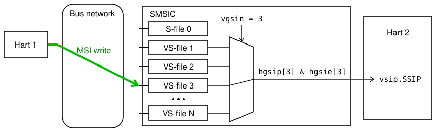
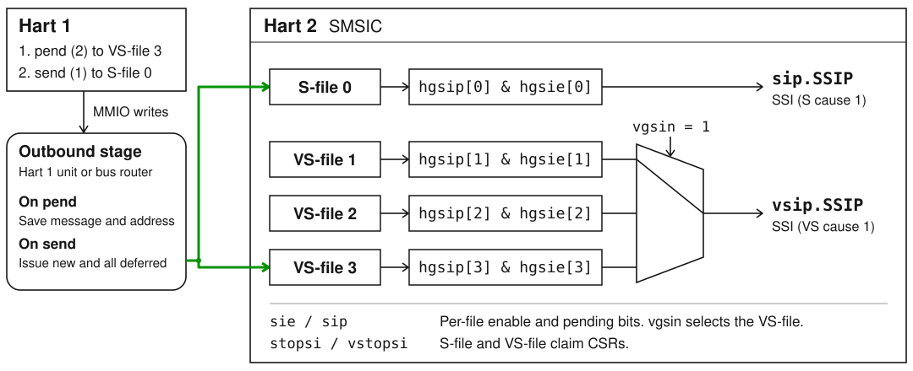

[[Ssaiasmsic]]
== "Ssaiasmsic" Extension for MSI Delivery of Supervisor Software Interrupts (Draft)

Ssaiasmsic adds a Single-id MSI Controller (SMSIC) to a hart
and requires Ssaia and Sscsrind.
To send an interprocessor interrupt (IPI), a hart writes an MSI to the
destination hart's supervisor interrupt file (S-file) or to one of its
guest interrupt files (VS-files). The S-file requests a supervisor
software interrupt (major interrupt code 1) when delivery is enabled.
<<Ssaiasmsic-overview>> shows delivery to a guest. The sender can write
directly from S-mode if it has write access to the destination page.
An IPI sent through a supervisor IMSIC file instead arrives as a
supervisor external interrupt (major interrupt code 9, <<IPIs>>).

[[Ssaiasmsic-overview]]
.Hart 1 writes to Hart 2's VS-file 3. With `vgsin` set to 3, the SMSIC requests a virtual supervisor software interrupt (VSSI) when both `hgsip[3]` and `hgsie[3]` are set. The figure shows VSSI delegated to VS-mode, where the guest observes `vsip`.SSIP.

=== Sending and claiming an IPI

Each SMSIC file implements one software-interrupt identity, with one
pending bit and one enable bit. The MSI address selects the destination
file. The little-endian MSI port is at offset 0 of the file's 4-KiB
page. The corresponding offset for a big-endian port is 4. The value
of a naturally aligned 32-bit write specifies an outbound operation.
The sending hart's outbound unit or a bus router processes the write
before an MSI reaches the destination SMSIC.

[cols="1m,1m,3",options="header"]
|===
|Outbound write value |Operation |Effect at the sender or bus router
|0 |ignore |Ignore the write.
|1 |send |Immediately transmit this message and flush all deferred messages.
|2 |pend |Defer this message until the next `send` operation.
|===

Other 32-bit write values have the same outbound effect as writing 1.
Software uses 1 to encode `send`. On a `pend` write, the outbound
unit or router holds the message and its destination address. On a
`send` write, it immediately issues an MSI for that write and one
for each deferred message, then clears the deferred entries. Each
MSI carries the `send` value 1 and its original destination address.

The receiving SMSIC handles every arriving MSI identically. It sets
the pending bit in the file named by the MSI address, including a
VS-file belonging to an inactive vCPU. Messages that reach an
already-pending file coalesce.
Software that needs to distinguish IPI reasons or count work
items must record them separately and order their publication before
the MSI write, as discussed in <<IPIs>>.

At the destination hart, supervisor software enables its S-file by
writing 1 to the SMSIC indirect register `sie` and can disable it by
writing 0. A pending, enabled S-file asserts bit 0 of `hgsip`.
The SMSIC requests a supervisor software interrupt (SSI) when bit 0
is set in both `hgsip` and `hgsie`.
The hart's interrupt delegation and enable controls govern whether
that signal causes a trap (<<MSLevel>>).

Supervisor software claims a request from the local S-file by
atomically exchanging zero with `stopsi` (e.g., `csrrw t0, stopsi, x0`).
The exchange returns 1 and clears the file's pending request if one
is available to claim. Otherwise it returns 0.

=== Addressing supervisor and guest files

Each file occupies a naturally aligned 4-KiB page. As in the IMSIC
address layout (<<IMSIC-systemMemRegions>>), the low 12 address bits
select a byte within the page. Immediately above bit 11 are the guest
index and then the hart index within a group. An optional group index
occupies a platform-defined field above the hart index. All other
address bits are fixed by the platform base address. The platform
description identifies each group's MMIO region, the index fields,
and the mapping from hart indices to harts.

Guest index 0 selects the hart's S-file. Positive indices select guest
interrupt files (VS-files). The XLEN=64 bitmap covers file numbers
0 through 16,383 (14 index bits). The XLEN=32 bitmap covers file
numbers 0 through 8,191 (13 index bits). Both counts include the S-file.
With _g_ guest-index bits in the platform's MMIO layout, consecutive
hart indices in a group are separated by 2^g^ pages. The number of
usable files also depends on the pages implemented for the hart.
With _g_ = 0, S-files occupy consecutive pages and there are no guest
pages.

=== Guest file selection and notification

A hart's SMSIC VS-files are independent of its IMSIC VS-files, even
when the two controllers use the same file number. Both organize
pending and enable state by interrupt identity. An SMSIC VS-file
needs two bits for its single identity. An IMSIC VS-file implements
63 to 2047 external interrupt identities and uses 126 to 4094 bits
for its pending and enable arrays (<<IMSIC-intrFilesAndIdents>>).

On each hart, `vgsin` selects the active SMSIC VS-file. It selects
both the file for local indirect access and the file whose enabled
interrupt report can request a virtual supervisor software interrupt
(VSSI) for the current virtual hart. Within the selected SMSIC file,
the indirect register `sie` accesses its enable bit and `sip` accesses its pending
bit. The hart's directly addressed `sie` and `sip` CSRs are separate
registers.

In <<Ssaiasmsic-two-harts>>, Hart 1 writes 2 (`pend`) to address A
(Hart 2's VS-file 3), then writes 1 (`send`) to address B
(Hart 2's S-file). The outbound unit or router
issues both MSIs. Hart 2 records the guest MSI in VS-file 3 even
though its `vgsin` selects VS-file 1. If software later selects
file 3, a pending, enabled report from that file can request VSSI.

The `hgsip` bitmap reports interrupts by file number, and the
corresponding `hgsie` bit enables delivery of each report. File 0
requests SSI when both bits are set. For a valid nonzero file number
_i_ selected by `vgsin`, the same condition requests VSSI for the
current virtual hart. Reports from other
VS-files remain associated with their respective virtual harts. HS
software can inspect their bitmap bits independently of the `vgsin`
selection.

Hart 2 uses `stopsi` to claim the S-file request. The lower path in
<<Ssaiasmsic-two-harts>> shows the pending bit seen by the current guest when
`hideleg`[2] is set. In that case `vsip`.SSIP is the VS view of
`hip`.VSSIP (<<VSLevel>>).

[[Ssaiasmsic-two-harts]]
.The MSI address selects the file that records a message. Here the guest MSI reaches VS-file 3 while `vgsin` selects VS-file 1 for VSSI delivery. SSI and VSSI are shown delegated to S-mode and VS-mode, respectively.

=== Register encodings

This draft proposes the following pair of direct CSR addresses in the
standard read/write space. The S and VS addresses differ by 0x100,
as do the addresses of `stopei` and `vstopei` (<<CSRs>>).

[cols="1m,1,1m,3",options="header"]
|===
|CSR address |Privilege |Name |Function
|0x15E |SRW |stopsi |Claim an S-file request
|0x25E |HRW |vstopsi |VS-level counterpart of stopsi
|===

[NOTE]
====
An alternative would reuse `stopei` and `vstopei` to report an SMSIC
request with external interrupt identity (EIID) 1. An atomic read and
write that claims this request would clear the SMSIC `sip` bit in the
S-file for `stopei` or in the VS-file selected by `vgsin` for `vstopei`.
This would save two CSR addresses but would couple the SMSIC claim
mechanism to the IMSIC. Whether software should claim an SMSIC request
through the dedicated software-interrupt CSRs or through EIID 1 remains
open for discussion.
====

The following encodings are proposed in the standard indirect register
space. The table gives the complete selector values for RV32 and RV64.
An implementation of Ssaiasmsic must support the selectors for its
implemented SMSIC registers. For example, to enable the S-file,
supervisor software writes `0x2800` to `siselect` and then writes 1
to `sireg`.

[cols="1m,1m,3",options="header"]
|===
|Selector |Name |Function
|0x2000–0x202A |hgsie |Delivery enables for the S-file and VS-files
|0x2400–0x242A |hgsip |Pending interrupt reports from the S-file and VS-files
|0x2800 |sie |Per-file software-interrupt enable
|0x2801 |sip |Per-file software-interrupt pending state
|0x2803 |vgsin |Select the VS-file for indirect access and VSSI delivery
|===

==== Accessing the notification enable and pending bitmaps

Each bitmap comprises 256 words of the current XLEN. Word _w_ covers
file numbers _w_ × XLEN through (_w_ + 1) × XLEN − 1, in increasing
bit order. Both widths access the same state for a given file number.
In word 0, bit 0 of `hgsip` reports the S-file interrupt and bit 0
of `hgsie` is its writable delivery enable.
Bits for unimplemented VS-files are read-only zeros in both bitmaps.

Each `siselect` value selects up to six consecutive words. With _B_
the first selector of the bitmap, writing _B_ + _k_ to `siselect`
maps consecutive bitmap words to the Sscsrind aliases as shown below.

[cols="1m,^1,^1,^1,^1,^1,^1",options="header"]
|===
|Alias |sireg |sireg2 |sireg3 |sireg4 |sireg5 |sireg6
|Word at B + k |6k |6k + 1 |6k + 2 |6k + 3 |6k + 4 |6k + 5
|===

For example, after writing `0x2400` to `siselect` once, HS software
can read `sireg` through `sireg6` in succession to obtain the first
six words of `hgsip`. Reading an alias leaves `siselect` unchanged.
Writing `0x2401` to `siselect` selects the next six words. The same
layout applies to reads and writes of `hgsie` starting at `0x2000`.

The last selector of each bitmap (_B_ + `0x2A`) exposes words 252
through 255 via `sireg` through `sireg4`. At that selector,
`sireg5` and `sireg6` read as zero and ignore writes. At XLEN=64,
bit 63 of `sireg4` represents file 16,383. At XLEN=32, bit 31 of
`sireg4` represents file 8,191.
